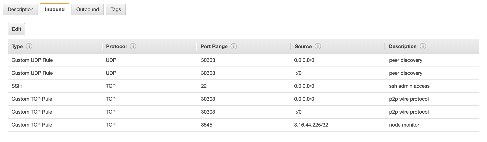

description: Pantheon networking is about P2P discovery and communication between peers and access to the JSON RPC APIs
<!--- END of page meta data -->

# Networking

Pantheon uses the network to find and connect to peers. 

## Port Configuration 

Ports must be exposed appropriately: 

* Peer discovery port must be open on both TCP and UDP. The [`--p2p-port`](../Reference/Pantheon-CLI-Syntax.md#p2p-port) option specifies the
  peer discovery port. The default is `30303`.
* Open the HTTP JSON-RPC and WebSockets JSON-RPC ports to the intended users of the JSON-RPC API on TCP. 
The [`--rpc-http-port`](../Reference/Pantheon-CLI-Syntax.md#rpc-http-port) and [`--rpc-ws-port`](../Reference/Pantheon-CLI-Syntax.md#rpc-ws-port) 
options specify the HTTP and WebSockets JSON-RPC ports. The defaults are `8545` and `8546`.  

An example port configuration for a Pantheon node on AWS is: 

## Node Connections

The default logging configuration does not list node connection and disconnection messages.  

To enable listing of node connection and disconnection messages, specify the 
[`--logging`](../Reference/Pantheon-CLI-Syntax.md#logging) command line option `--logging=DEBUG`.
For more verbosity, specify `--logging=TRACE`.  

The console logs connection and disconnection events when the log level is `DEBUG` or higher.  
If `Successfully accepted connection from ...` is displayed, connections are getting through the firewalls. 

!!! example "Example log output"
    `2018-10-16 12:37:35.479-04:00 | nioEventLoopGroup-3-1 | INFO  | NettyP2PNetwork | Successfully accepted connection from 0xa979fb575495b8d6db44f750317d0f4622bf4c2aa3365d6af7c284339968eef29b69ad0dce72a4d8db5ebb4968de0e3bec910127f134779fbcb0cb6d3331163c`
 
## Limiting Peers

Limiting peers reduces the bandwidth used by Pantheon. It also reduces the CPU time and disk access 
used to manage and respond to peers.  
 
Use the [`--max-peers`](../Reference/Pantheon-CLI-Syntax.md#max-peers) command line option to reduce 
the maximum number of peers. The default is 25.

## No Discovery

The [`--discovery-enabled`](../Reference/Pantheon-CLI-Syntax.md#discovery-enabled) command line option 
can be used to disable P2P peer discovery.
Set this option to `false` if you are running a test node or a test network with fixed nodes.

Use the [`admin_addPeer`](../Reference/JSON-RPC-API-Methods.md#admin_addpeer) JSON-RPC method to add peers when 
[`--discovery-enabled`](../Reference/Pantheon-CLI-Syntax.md#discovery-enabled) is set to false. 

## Monitoring Peer Connections

Use the [`debug_metrics`](../Reference/JSON-RPC-API-Methods.md#debug_metrics) JSON-RPC API method 
to obtain information about peer connections.   