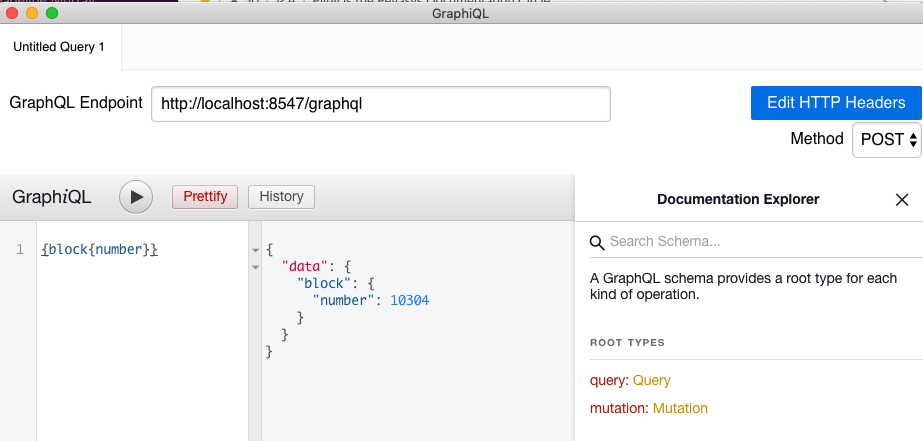

description: How to access the Pantheon API using GraphQL-RPC
<!--- END of page meta data -->

# GraphQL over HTTP

To enable GraphQL-RPC over HTTP, use the [`--graphql-http-enabled`](../Reference/Pantheon-CLI-Syntax.md#graphql-http-enabled) 
option.

## GraphQL Requests with Curl 

```bash
curl -X POST -H "Content-Type: application/json" --data '{ "query": "{ protocolVersion }" }' http://localhost:8547/graphql
```


## GraphQL Requests with GraphiQL App

The [GraphiQL app](https://github.com/skevy/graphiql-app) provides a tabbed interface for editing and testing GraphQL 
queries and mutations. GraphiQL also provides access the Pantheon GraphQL schema from within the app. 

 


Examples in Pantheon API Methods - eth_ methods only 