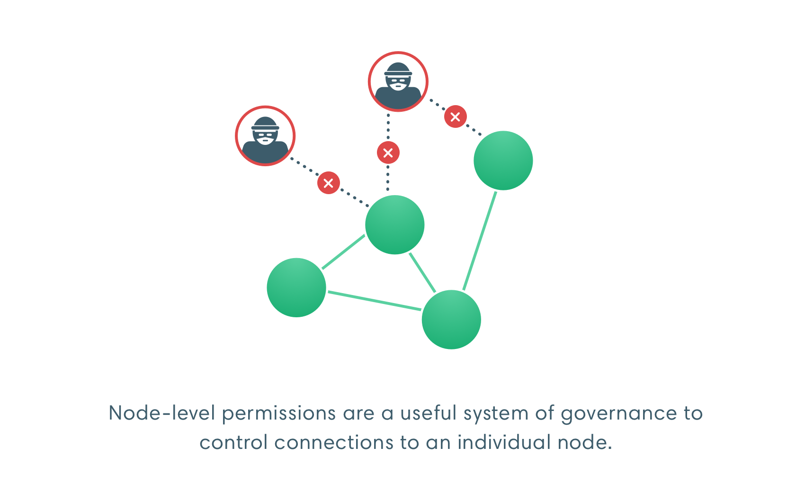
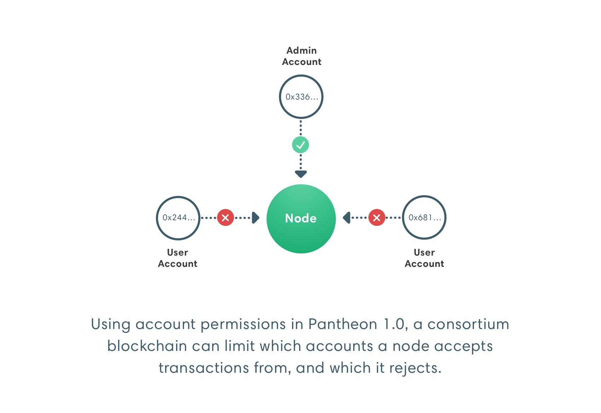

description: Pantheon Permissions feature
<!--- END of page meta data -->

# Permissions 

A permissioned network is a network where only specified nodes and accounts (participants) can participate. 
Nodes and accounts outside those specified are prevented from participating. Permissioned networks can have node permissions enabled, 
account permissions enabled, or both. 

## Local 

[Local permissions](Local-Permissioning.md) are specified at the node level. Each node in the network has a [permissions configuration file](#permissions-configuration-file).
Permissions updates must be made to the configuration file for each node. 

## Onchain 

Onchain permissions are specified in a smart contract on the network. Specifying permissions onchain
enables all nodes to read and update permissions in one location. 

!!! note
    Onchain permissions for nodes is under development and will be available in v1.1. Onchain permissions
    for accounts will be available in a future Pantheon release. 