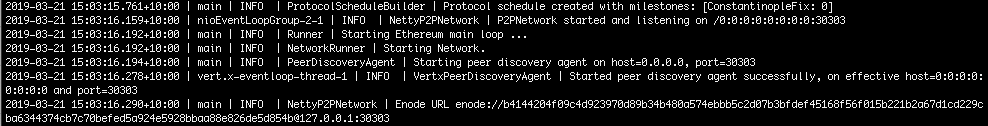

description: Configuring Privacy
<!--- END of page meta data -->

# Configuring a Network for Private Transactions 

Configuring a network that supports private transactions requires starting an Orion node for each
Pantheon node. Pantheon command line options associate the Pantheon node with the Orion node. 

This tutorial assumes you have completed the set up of an IBFT 2.0 network to end of the step 
[creating the genesis file](../Tutorials/Create-IBFT-Network.md#5-create-genesis-file). 

We will start Orion nodes for all three Pantheon nodes and configure each Pantheon node to be associated 
with an Orion node. 

## 1. Create Orion Directories

Inside each Node directory, create an Orion directory: 

```bash
IBFT-Network/
├── Node-1
│   ├── data
│   ├── Orion
├── Node-2
│   ├── data
│   ├── Orion
└── Node-3
    ├── data
    ├── Orion 
```

## 2. Create Password Files
       
In each Orion directory, create a file called `passwordFile` containing a password to encrypt each Orion key pair. 

## 3. Generate Orion Keys
   
In each Orion directory, generate a public/private keypair for the Orion node:
   
``` bash
orion -g nodeKey
```
   
At the prompt, enter the [password](#2-create-password-files) to encrypt the key pair. 
   
The Orion public/private key pair is generated and the keys saved in the `nodeKey.pub` and `nodeKey.key` files.

## 4. Create Orion Configuration Files
   
In the `Node-1/Orion` directory, create a file called `orion.conf` and add the following properties:
   
```
nodeurl = "http://127.0.0.1:8080/"
nodeport = 8080
clienturl = "http://127.0.0.1:8888/"
clientport = 8888
publickeys = ["nodeKey.pub"]
privatekeys = ["nodeKey.key"]
passwords = "passwordFile"
tls = "off"
```

!!! important 
    Add something about production systems and TLS. 
    
In the `Node-2/Orion` and `Node-3/Orion` directories, create `orion.conf` files with the same values 
except for specifying different ports: 

```bash tab="Node-2"
nodeurl = "http://127.0.0.1:8081/"
nodeport = 8081
clienturl = "http://127.0.0.1:8889/"
clientport = 8889
publickeys = ["nodeKey.pub"]
privatekeys = ["nodeKey.key"]
passwords = "passwordFile"
tls = "off"
```

```bash tab="Node-3"
nodeurl = "http://127.0.0.1:8082/"
nodeport = 8082
clienturl = "http://127.0.0.1:8890/"
clientport = 8890
publickeys = ["nodeKey.pub"]
privatekeys = ["nodeKey.key"]
passwords = "passwordFile"
tls = "off"
```
   
## 5. Start Orion Nodes
   
In each `Orion` directory, start Orion specifying the [configuration file](#3-create-a-configuration-file):
   
```
orion orion.conf
```

?? Don't the Orion nodes need a bootnode to find each other? 

## 6. Start Pantheon Node-1

In the `Node-1` directory, start Node-1:

```bash tab="MacOS"
pantheon --data-path=data --genesis-file=../ibftGenesis.json --rpc-http-enabled --rpc-http-api=ETH,NET,IBFT,EEA --host-whitelist=* --rpc-http-cors-origins="all" --privacy-enabled --privacy-url=http://127.0.0.1:8888 --privacy-public-key-file=Orion/nodeKey.pub    
```

```bash tab="Windows"
pantheon --data-path=data --genesis-file=..\ibftGenesis.json --rpc-http-enabled --rpc-http-api=ETH,NET,IBFT,EEA --host-whitelist=* --rpc-http-cors-origins="all" --privacy-enabled --privacy-url=http://127.0.0.1:8888 --privacy-public-key-file=Orion\nodeKey.pub   
```

!!!note
    Update this to add privacy public key file. 
    The [`--genesis-file`](../Reference/Pantheon-CLI-Syntax.md#genesis-file) option is not used when running 
    Pantheon from the [Docker image](../Getting-Started/Run-Docker-Image.md). Use a bind mount to 
    [specify a configuration file with Docker](../Getting-Started/Run-Docker-Image.md#custom-genesis-file).

The command line specifies privacy options: 

* [`--privacy-enabled`](../Reference/Pantheon-CLI-Syntax.md#privacy-enabled) enables privacy
* [`--privacy-url`](../Reference/Pantheon-CLI-Syntax.md#privacy-url) specifies the Orion node URL (`clienturl` in `orion.conf`)
* [`--privacy-public-key-file`](../Reference/Pantheon-CLI-Syntax.md#privacy-public-key-file) specifies the file containing
Orion node public key (created in [3. Generate Orion Keys](#3-generate-orion-keys))
* [`--rpc-http-api`](../Reference/Pantheon-CLI-Syntax.md#rpc-http-api) includes `EEA` enabling privacy JSON-RPC API methods.  


When the node starts, the [enode URL](../Configuring-Pantheon/Node-Keys.md#enode-url) is displayed.
Copy the enode URL to specify Node-1 as the bootnode in the following steps. 



### 7. Start Node-2 

Start another terminal, change to the `Node-2` directory and start Node-2 specifying the Node-1 enode URL copied when starting Node-1 as the bootnode:
 
```bash tab="MacOS"
pantheon --data-path=data --genesis-file=../ibftGenesis.json --bootnodes=<Node-1 Enode URL> --p2p-port=30304 --rpc-http-enabled --rpc-http-api=ETH,NET,IBFT --host-whitelist=* --rpc-http-cors-origins="all" --rpc-http-port=8546 --privacy-enabled --privacy-url=http://127.0.0.1:8889 --privacy-public-key-file=Orion/nodeKey.pub    
```

```bash tab="Windows"
pantheon --data-path=data --genesis-file=..\ibftGenesis.json --bootnodes=<Node-1 Enode URL> --p2p-port=30304 --rpc-http-enabled --rpc-http-api=ETH,NET,IBFT --host-whitelist=* --rpc-http-cors-origins="all" --rpc-http-port=8546 --privacy-enabled --privacy-url=http://127.0.0.1:8889 --privacy-public-key-file=Orion\nodeKey.pub    
```

The command line specifies the same options as for Node-1 with different ports and URL for the Orion node.  The 
[`--bootnodes`](../Reference/Pantheon-CLI-Syntax.md#bootnodes) option specifies the enode URL for Node-1.

### 8. Start Node-3

Start another terminal, change to the `Node-3` directory and start Node-3 specifying the Node-1 enode URL copied when starting Node-1 as the bootnode: 

```bash tab="MacOS"
pantheon --data-path=data --genesis-file=../ibftGenesis.json --bootnodes=<Node-1 Enode URL> --p2p-port=30305 --rpc-http-enabled --rpc-http-api=ETH,NET,IBFT --host-whitelist=* --rpc-http-cors-origins="all" --rpc-http-port=8547 --privacy-enabled --privacy-url=http://127.0.0.1:8890 --privacy-public-key-file=Orion/nodeKey.pub   
```

```bash tab="Windows"
pantheon --data-path=data --genesis-file=..\ibftGenesis.json --bootnodes=<Node-1 Enode URL> --p2p-port=30305 --rpc-http-enabled --rpc-http-api=ETH,NET,IBFT --host-whitelist=* --rpc-http-cors-origins="all" --rpc-http-port=8547 --privacy-enabled --privacy-url=http://127.0.0.1:8890 --privacy-public-key-file=Orion\nodeKey.pub   
```

The command line specifies the same options as for Node-1 with different ports and URL for the Orion node.  The 
[`--bootnodes`](../Reference/Pantheon-CLI-Syntax.md#bootnodes) option specifies the enode URL for Node-1.

