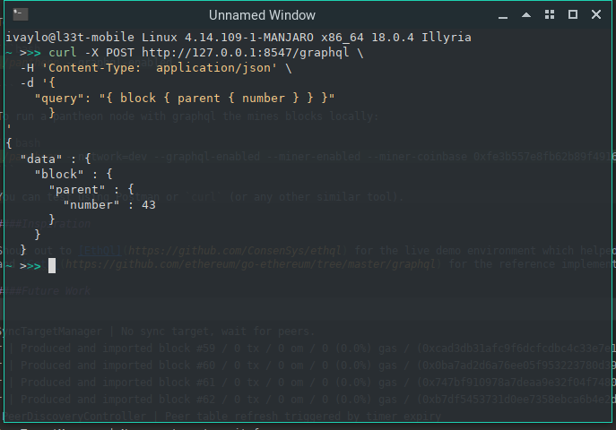
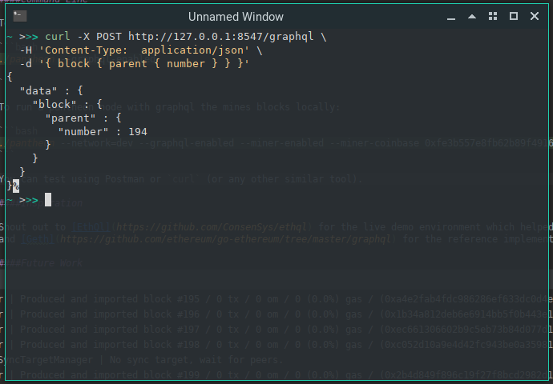

### Pantheon GraphQL Implementation by Ivaylo Kirilov & Fred Lacs

#### Query structure

Below are two examples of valid query syntax. You can send a structured query in the payload of your http call:
*N.B* fields that are null may be ommited ( see screenshot )
```json
{
  "operationName": null,
  "query": "<query>",
  "variables": {}
  
}
```

or you can send the raw query in the payload of your http call:
```json
"<query>"
``` 

You can find example queries in the tests.

##### Reasoning

The GraphQL recommended query structure follows the first example. For convenience we have also made it possible to process a
raw query.
In the future we see the `operationName` field to be useful for authorization. When authentication is enabled, the query will
include the `operationName` as defined in `GraphQLMethodType` to allow fine-tuning of who can execute what types of queries on
a node.

#### Completness

The aim of this exercise was to implement a graphql endpoint adhering to the latest spec 
defined in [EIP-1767](https://eips.ethereum.org/EIPS/eip-1767) 
as “a complete replacement to the read-only information exposed via the present JSON-RPC interface”. 
All 24 RPC calls marked as "IMPLEMENTED" in the EIP were implemented.
To verify the code works correctly run the parameterized tests. 
There are also integration tests.
Code coverage is at 63% - the reason for this is that boilerplate code for authentication 
is not covered by the tests.

#### Command Line

To start pantheon with graphql enabled against mainnet the minimum command is

```bash
./pantheon --graphql-enabled

```

To run a pantheon node with graphql the mines blocks locally:

```bash
./pantheon --network=dev --graphql-enabled --miner-enabled --miner-coinbase 0xfe3b557e8fb62b89f4916b721be55ceb828dbd73
```

The default GraphQL service url is `http://locahost:8545`. It is possible to modify this using the `--graphql-host` 
and `--graphql-port` flag similar to how you would configure JSON-RPC service.

The flags `--graphql-cors-origins` and `--graphql-authentication-enabled` are also available but not tested.

#### Inspiration

Shout out to [EthQL](https://github.com/ConsenSys/ethql) for the live demo environment which helped us understand how GraphQL works
and [Geth](https://github.com/ethereum/go-ethereum/tree/master/graphql) for the reference implementation.

#### Future Work

Just because this hackathon is over does not mean then fun ends there.
We propose 3 areas to consider for future work together with rational for each.

1. Better testing. Due to the nature of hackathons testing is often overlooked.
Even though testing was part of the problem domain there is always room for improvement.
We would like to implement more unit/integration and some day even an acceptance test.
In particular there is lack of testing around the functionality GraphQL brings, that was
not previously possible with JSON-RPC, because there is no data to test against.

2. Integrate authorization of GraphQL methods. This should be self-explanatory, however
due to our approach of closing mirroring the JSON-RPC HTTP service set-up we already have
most of the code in place to achieve this. It really is only a matter of testing it.

3. More Queries. Just because we have implemented the spec does not mean we are
making full use of GraphQL. There are a significant number of methods that can be
introduced in the GraphQL schema that can be specific to Pantheon. For instance, it is
possible to manage Clique consensus via GraphQL and also private transaction support.

#### Feedback

Even though this task is epic in size it is definitely one of the most fullfilling
in terms of number of things learned during the process. We also welcome your feedback.